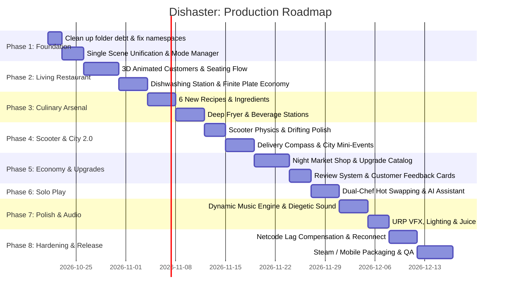
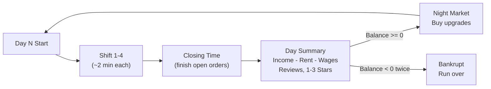

# 🍳 DISHASTER: CITY EXPRESS — ULTIMATE PRODUCTION MASTERPLAN
> **From Working Prototype to High-Octane Commercial Release**  
> *Target Platform: PC (Steam / Windows) [Primary Focus] | Engine: Unity 6 (6000.5.10f1) URP | Multiplayer: Netcode for GameObjects*

---

> [!IMPORTANT]
> **Read [Section 10 — Plan Review v2](#10-plan-review-v2--corrections-risks--new-ideas) first.** It corrects several assumptions below, lists code bugs to fix before adding content, and replaces the 8-sprint order with a **Vertical Slice first** approach.

## 📑 TABLE OF CONTENTS
1. [Executive Summary & Core Game Vision](#1-executive-summary--core-game-vision)
2. [Deep Audit of Current POC (What Works vs. Gaps)](#2-deep-audit-of-current-poc)
3. [The MCP Connection Blueprint (Direct Editor Integration)](#3-the-mcp-connection-blueprint)
4. [Master Gameplay Loop & Role Synergy](#4-master-gameplay-loop--role-synergy)
5. [Low-Poly Character Overhaul & Animation Architecture](#5-low-poly-character-overhaul--animation-architecture)
6. [Professional Restaurant & Level Design Blueprint](#6-professional-restaurant--level-design-blueprint)
7. [Feature Roadmap: Phase-by-Phase Architecture](#7-feature-roadmap-phase-by-phase-architecture)
8. [Step-by-Step Sprint Execution Schedule](#8-step-by-step-sprint-execution-schedule)
9. [Definition of Done & Quality Checklist](#9-definition-of-done--quality-checklist)
10. [Plan Review v2 — Corrections, Risks & New Ideas](#10-plan-review-v2--corrections-risks--new-ideas)

---

## 1. Executive Summary & Core Game Vision

### 1.1 The Unique Pitch
Current cooking games (*Overcooked!*, *PlateUp!*) keep players trapped strictly inside kitchen walls. 
**Dishaster: City Express** breaks the boundaries by combining:
1. **Intense Co-op Kitchen Chaos** (preparing, chopping, frying, plating, and putting out literal grease fires).
2. **Dine-In Front-of-House Service** (serving tables, clearing dirty dishes, managing customer patience).
3. **Open-City Scooter Courier Deliveries** (packing insulated delivery bags, hopping on electric scooters, navigating traffic, and making rush deliveries across a living procedural city).

### 1.2 Target Experience
- **1 to 4 Players Online or Solo.**
- **The Core Loop:** Customers arrive at dining tables; takeout orders ping the delivery terminal. Players must communicate and divide roles between **Chef** (cooking & dish plating), **Maitre D' / Busser** (serving tables & washing dishes), and **Courier** (driving scooters into the city). At the end of each shift, players pay rent, review customer star ratings, and spend profits in the **Night Market Catalog** to buy kitchen upgrades, vehicle boosters, and automation gadgets.

---

## 2. Deep Audit of Current POC

### 2.1 What Already Exists and Functions
| System | Current State | Code Health |
| :--- | :--- | :--- |
| **Kitchen Core** | Base counters, chopping, stove frying, burning, plate combination, trash | Solid, CodeMonkey foundation |
| **Multiplayer** | Unity Netcode for GameObjects + Relay + Lobby + Character Color Select | Functional, basic sync working |
| **Table Service Mode** | `CustomerTable`, `TableManager`, table timers, UI billboard | Basic logic in place; tables currently act like passive drop counters |
| **City Life Simulation** | `CityGenerator`, arterial road grid, cars, pedestrians, waypoint graph | Procedural city spawns cleanly |
| **Sidewalk Delivery** | `DeliveryBagCounter`, `DeliveryBagKitchenObject` (holds 3 plates), `DeliveryCustomerManager` | Functional, requires delivery bag packaging |
| **Vehicle System** | `ElectricScooter` with mounting [F], speed boost (16f), motor sound | Working network mount and drive |
| **Kitchen Crises** | Blackout (fuse box), Water Pipe Leak (slippery puddle + wrench), Stove Fire (extinguisher) | Clean C# events and Netcode sync |
| **Difficulty Progression** | 4 Shifts (Morning Prep, Lunch Rush, Dinner Surge, Overdrive) | Fully parameterized in Inspector |
| **Economy & Survival** | Cash balance, rent cycles, star rating (1-5 stars), bankruptcy game over | Working, but lacks an upgrade/shop outlet |
| **Mobile Controls** | Dynamic joystick, primary/secondary action buttons | Implemented with auto platform detection |

### 2.2 Critical Missing Links & Design Flaws
1. **The "Empty Table" Illusion:** Customers do not physically exist at dining tables. Tables are just wooden counters with a floating UI canvas. There are no 3D animated NPCs walking in, sitting down, eating, or complaining.
2. **No Dishwashing Loop:** In all successful restaurant games, plates are finite. You serve a dish -> customer eats -> leaves dirty plate -> player must take dirty plate to the sink and wash it before reuse. Currently, `PlatesCounter` produces infinite plates.
3. **The "Nothing to Buy" Economy:** Players earn money and survive rent cycles, but they have zero agency to spend cash. A restaurant sim requires between-shift or mid-game purchases (upgrades, gadgets, speed boosts).
4. **Solo Play is Brutal:** Single-player currently spawns 1 chef who has to cook, wash, serve tables, AND drive 200m across the city. Solo mode needs dual-chef hot-swapping (like *Overcooked*) or an AI helper.
5. **Limited Recipe Variety:** Currently only 4 recipes: Plain Burger, Cheeseburger, MEGAburger, and Salad. Cooking becomes repetitive within 5 minutes.
6. **Delivery Bag Polish:** Packing plates into the delivery bag needs better feedback, hot-food decay timer, and clear UI indicators on the scooter HUD.
7. **File Organization Debt:** Script duplication detected in `Assets/Scripts/Assets/Scripts/UI/TableOrderUI.cs` — misplaced subfolder created during previous patch.

---

## 3. The MCP Connection Blueprint

To enable the Antigravity agent to make direct modifications to GameObjects, inspect scene hierarchies, edit materials, modify components, and run Unity test suites directly from the prompt, we leverage the **`com.coplaydev.unity-mcp`** package already installed in your project.

### 3.1 Step 1: Activate MCP for Unity in the Editor
1. In the Unity Editor top menu, navigate to:  
   **Window > MCP for Unity** (or press `Ctrl + Shift + M`).
2. In the window that opens, verify:
   - **Mode:** `Auto` or `Standard`
   - **Transport:** HTTP or stdio (ports are shown in the window; they vary by package version).
3. Click **"Auto-Setup"**. This verifies Python / `uvx` dependencies.
4. Click **"Start Bridge"** if the Unity Bridge indicates "Stopped" (it should turn green: `Connected ✓`).

### 3.2 Step 2: Register MCP Server with Antigravity
> [!WARNING]
> Don't hand-write this config from guesses. The server path, command, and port depend on the installed `unity-mcp` version (`/MCPForUnity` is the **Unity package** folder, not the Python server).

1. In **Window > MCP for Unity > MCP Client Configuration**, pick any client, then click **"Manual Setup"**. It shows the exact JSON (`uvx --from <git-url> mcp-for-unity` for stdio, or a local URL for HTTP).
2. Copy the `mcpServers` entry into `~/.gemini/config/mcp_config.json` (Antigravity uses the same `command`/`args` or `serverUrl` schema).
3. Requirements: Python + `uv`/`uvx` on PATH (the window's "Auto-Setup" checks this).
4. Keep the Unity Editor open with the bridge running whenever the agent needs Editor access.

### 3.3 What the Agent Can Do Once Connected
- **Hierarchy & Scene Inspection:** Inspect GameObjects, transforms, tag/layer configs, and component properties without guessing.
- **Component & Prefab Tweaks:** Add components, modify serialized fields, assign ScriptableObjects, and wire up Inspector event listeners.
- **Console Log Monitoring:** Instantly read compilation errors, runtime exceptions, and Netcode RPC warnings.
- **Automated Play-Testing:** Start and stop Play Mode programmatically to verify gameplay mechanics in real-time.

---

## 4. Master Gameplay Loop & Role Synergy

```
                      ┌─────────────────────────────────────────┐
                      │             THE RESTAURANT              │
                      │                                         │
 ┌─────────────────┐  │   ┌───────────────┐ ┌─────────────────┐ │  ┌──────────────────┐
 │  DINE-IN GUESTS ├──┼──►│  TABLE SEATS  │ │   THE KITCHEN   │ │  │ OUTDOOR COURIER  │
 │ (Walk in & Sit) │  │   │ (Eat & Leave) │ │(Cook, Chop, Fry)│ │  │ (Scooter & City) │
 └────────┬────────┘  │   └───────┬───────┘ └────────┬────────┘ │  └────────┬─────────┘
          │           │           │                  │          │           │
          ▼           │           ▼                  ▼          │           ▼
   Table Orders ──────┼───────────┼──────────► Plated Dishes ───┼──► Takeout Bags
                      │           │                             │           │
                      │           ▼                             │           ▼
                      │     Dirty Dishes                        │     City Customers
                      │           │                             │           │
                      │           ▼                             │           ▼
                      │      Sink Station ──────────────────────┼───── Cash & Tips
                      │     (Clean Plates)                      │           │
                      └─────────────────────────────────────────┘           │
                                           │                                │
                                           ▼                                ▼
                                ┌──────────────────────────────────────────────┐
                                │          NIGHTLY SHIFT CONCLUSION            │
                                │   - Pay Inflating Rent/Utilities             │
                                │   - Review Yelp/Google Star Reviews          │
                                │   - Upgrade Kitchen & Scooters at Shop       │
                                └──────────────────────────────────────────────┘
```

### The Three Symbiotic Player Roles
1. **The Executive Chef (Kitchen):**
   - Monitors dining room orders on the order rail and takeout tickets on the delivery station.
   - Manages cutting boards, stoves, burger assembly, and deep frying.
   - Puts out grease fires and resets tripped fuse boxes during power surges.
2. **The Maitre D' / Busser (Front-of-House):**
   - Delivers fresh dishes from the kitchen to table seats.
   - Clears empty dirty plates when guests finish eating.
   - Operates the **Dishwashing Sink**: washes plates with water to return them to the clean plate rack.
   - Repairs burst pipe leaks with the pipe wrench before slippery puddles flood the dining area.
3. **The Urban Courier (City Express):**
   - Packs completed meals from the `DeliveryBagCounter` into an insulated thermal bag (1-3 plates).
   - Mounts the **Electric Scooter**, revs down the sidewalk, and navigates city traffic to reach delivery pins.
   - Hand-delivers orders to customers on street corners for massive tips and 5-star ratings.
   - Rushes back before the next rush hour wave hits.

---

## 5. Low-Poly Character Overhaul & Animation Architecture

### 5.1 The Problem with the Current Placeholder
Currently, the player is CodeMonkey's prototype model consisting of **two primitive Unity spheres stacked on top of each other** (`Head` + `Body`) with two black bead eyes and a basic vertical bounce animation. Similarly, pedestrians are animated primitive capsules. This breaks immersion and prevents the game from feeling like a polished, commercial release.

### 5.2 The Low-Poly Humanoid Solution
We replace the 2-sphere placeholder with a cohesive, stylized **Low-Poly Humanoid Rig**:
- **Source Assets:**
  - Standard **CC0 / Free Humanoid Character Packs** (e.g. *KayKit Character Pack*, *Kenney Animated Characters*, or *Quaternius Stylized Modular Characters*).
  - Designed with cute, readable proportions (chibi/stylized aesthetic) that perfectly match the low-poly city and kitchen counters.
- **Chef Outfits & Customization:**
  - Classic white chef double-breasted jacket, apron, chef toque (hat), and comfortable non-slip clogs.
  - **Dynamic Player Color Tinting:** Instead of tinting the entire character's body a flat solid color, `PlayerVisual.cs` will selectively tint the **apron, bandana, or hat brim** with the player's selected multiplayer color (Red, Blue, Green, Yellow), keeping skin tones and eyes natural and charming.
- **Shared Rig for Customers & Civilians:**
  - The exact same rig powers dine-in customers and city delivery recipients, swapping the chef jacket for casual shirts, hoodies, and jackets.

### 5.3 Complete Humanoid Animation Suite (Mecanim + Mixamo)
Using Unity's standard **Humanoid Avatar** mapping, we wire up a full state machine in `PlayerAnimator.cs`:
| Animation State | Visual Description | Trigger Condition |
| :--- | :--- | :--- |
| **Idle** | Weight-shifting, breathing, energetic chef bounce | `MoveDir == 0 && !IsHolding` |
| **Jog / Run** | Dynamic stylized run with slight forward torso lean | `MoveDir > 0 && !IsHolding` |
| **Carry Idle** | Hands held forward at chest height holding plate/bag | `HasKitchenObject && MoveDir == 0` |
| **Carry Run** | Running while balancing a plate/bag with both hands | `HasKitchenObject && MoveDir > 0` |
| **Chopping** | Rhythmic two-handed knife downstrokes with blade contact | `SelectedCounter is CuttingCounter && AlternateAction` |
| **Cooking / Sizzle** | Stirring frying pan or flipping patty with spatula | Near active stove with cooking item |
| **Dish Scrubbing** | Circular scrubbing motions with water splash particles | Interacting at Sink Counter |
| **Scooter Driving** | Feet positioned on deck, hands gripping handlebars, leaning into turns | `isMountedOnVehicle == true` |
| **Puddle Slip / Stumble** | Comedic backward flail and arms windmilling before recovery | Running through active water puddle |
| **Order Victory Cheer** | Fist pump or excited jump when a 5-star order is completed | Delivery success event |

---

## 6. Professional Restaurant & Level Design Blueprint

### 6.1 Architectural Layout Principles
The current `GameSceneTableService` places counters inside a box of generic grey `Cube` wall colliders. We replace this with a **deliberate architectural blueprint**:

```
 ══════════════════════════════ CITY SIDEWALK & ROAD ══════════════════════════════════
                          ▲                          ▲
                 [Ramp to Street]            [Customer Front Door]
                          │                          │
  ┌───────────────────────┴──────────────────────────┴─────────────────────────────┐
  │                                                                               │
  │     🛵 SCOOTER BAY            FRONT-OF-HOUSE (DINING ROOM)                     │
  │   [Painted Stall Lines]                                                       │
  │   [Charging Dock]          [Booth 1]    [Booth 2]     [Host Podium]           │
  │                              EggTable     EggTable    (NPCs Walk In)          │
  │   ┌──────────────────┐                                                        │
  │   │  TAKEOUT WINDOW  │     [Booth 3]    [Booth 4]     (Ambient Pendant Lamps) │
  │   │ (Delivery Bags)  │       EggTable     EggTable                            │
  │   └────────┬─────────┘                                                        │
  │            │                                                                  │
  ├────────────┼──────────────────────── SERVICE PASS ────────────────────────────┤
  │            │                    [Pass-Through Window]                         │
  │            ▼                      (Pick up plates)                            │
  │   BACK-OF-HOUSE (THE KITCHEN)                                                 │
  │                                                                               │
  │   ┌────────────────────┐   ┌───────────────────────────┐   ┌──────────────┐   │
  │   │   PREP STATION     │   │     COOKING LINE          │   │  WASH PIT    │   │
  │   │ Crate -> Cutting   │   │ Stoves -> Deep Fryer      │   │ Sink Counter │   │
  │   │ (Cabbage, Tomato)  │   │ (Burger Patties, Fries)   │   │ Clean Rack   │   │
  │   └────────────────────┘   └───────────────────────────┘   └──────────────┘   │
  │                                                                               │
  │          [Trash Bin]            [Fire Extinguisher]           [Fuse Box]      │
  └───────────────────────────────────────────────────────────────────────────────┘
```

### 6.2 Key Zone Specifications
1. **The Commercial Kitchen (Back-of-House):**
   - **Ergonomic Work Triangle:** Linear placement from raw ingredient crates $\rightarrow$ chopping boards $\rightarrow$ stoves/fryers $\rightarrow$ assembly counters $\rightarrow$ pass-through window.
   - **Corridor Width:** Minimum 1.8 meters between counter islands to allow two players to pass each other comfortably without getting caught on colliders.
   - **Strategic Pressure Points:** A swinging double kitchen door connecting kitchen to dining room creates intentional, hilarious co-op close calls ("Coming in hot!").
2. **The Dining Room (Front-of-House):**
   - Built using checkered tile flooring, warm pendant ceiling lamps, brick wall accents, and the existing `EggTable` / `EggStool` prefabs arranged in cozy dining booths.
   - Clear wide aisles leading from the service pass to each table so food bussers can navigate swiftly.
   - Glass frontage offering a clear view of the bustling city streets outside.
3. **The Takeout Hatch & Dedicated Scooter Bay:**
   - Dedicated service window directly connecting the delivery bag packing counter to the exterior sidewalk.
   - Exterior asphalt parking stall painted with yellow "DELIVERY ONLY" markings.
   - Smooth sidewalk curb ramp enabling seamless scooter acceleration into the street without getting stuck on curb edges.
4. **Multi-Stage Campaign Progression (4 Distinct Level Archetypes):**
   - **Level 1: The Sunny Side Diner:** Open, accessible layout, 3 dining tables, wide sidewalks, light traffic. Perfect onboarding stage.
   - **Level 2: Downtown Burger Bar:** High-density city block, split kitchen with a central pass, 5 busy dining tables, and fast 4-lane cross-traffic.
   - **Level 3: Harbor Boardwalk Grill:** Seaside cafe with wooden boardwalk planks, outdoor patio tables, and long straightaways for high-speed scooter delivery runs.
   - **Level 4: Industrial Ghost Kitchen:** Zero indoor dining tables; 100% extreme delivery rush with conveyor belts, high order frequencies, and frequent kitchen crises.

---

## 7. Feature Roadmap: Phase-by-Phase Architecture



---

### Phase 1: Housekeeping & Architectural Foundation
**Objective:** Unify code structure, remove technical debt, and ensure zero-warning compilation.

1. **Move Misplaced Files & Fix Folder Hierarchy:**
   - Move `Assets/Scripts/Assets/Scripts/UI/TableOrderUI.cs` to `Assets/Scripts/UI/TableOrderUI.cs`.
   - Delete empty/stale directories `Assets/Scripts/Assets/`.
   - Update any assembly definitions or metadata references.
2. **Unified Game Flow & Mode Selection:**
   - Currently, the game is split between `GameScene` (Classic) and `GameSceneTableService` (Table Service + City).
   - Consolidate into a single scalable master scene or a unified setup where `GameMode` dynamically toggles city delivery and dining tables seamlessly without duplicating scene assets.
   - Make the Main Menu mode selection clearly explain the two game types:
     - **Arcade Rush (Classic):** Traditional Overcooked-style high-score challenge against the clock.
     - **Restaurant Survival (City Express):** The full flagship mode with dine-in tables, sidewalk deliveries, rent survival, and kitchen crises.

---

### Phase 2: The Living Dine-In Restaurant
**Objective:** Transform customer tables from passive counters into an animated, organic dining room.

1. **3D Customer Spawning & Seating State Machine:**
   - Customers walk in through the front door from the sidewalk (`WaitingToSeat` -> `WalkingToTable` -> `SeatedOrdering` -> `WaitingForFood` -> `Eating` -> `Finished` -> `Leaving`).
   - Implement patience meters with animated mood emojis (😊 Happy -> 😐 Impatient -> 😡 Angry -> 💥 Walkout).
   - If a customer walks out: rating drops by 0.5 stars, and a penalty fine is applied.
2. **The Dishwashing Loop & Finite Plates:**
   - Remove infinite plate spawning from `PlatesCounter`.
   - When customers finish eating, they leave a **DirtyPlateKitchenObject** on the table.
   - Introduce the **SinkCounter**:
     - Player places dirty plates in sink.
     - Hold [Interact] to scrub (progress bar with water splash particles & scrubbing audio).
     - Clean plates stack onto the dish drying rack, ready for the cook.

---

### Phase 3: Expanded Culinary Arsenal
**Objective:** Deepen cooking gameplay with distinct preparation workflows and appetizing recipes.

1. **New Kitchen Stations:**
   - **Deep Fryer Counter:** Fry French fries and onion rings with bubbling oil sounds, boiling particles, and a drain basket timer.
   - **Beverage Station:** Dispense fountain sodas and brew hot coffee pots for dine-in tables and combo delivery orders.
2. **6 New Production Recipes:**
   - 🍔 **Bacon Double Deluxe:** Bread + Cooked Patty + Cheese + Bacon + Tomato + Bread.
   - 🍟 **Crispy French Fries:** Potato -> Cut into Slices -> Deep Fry.
   - 🥤 **Fountain Soda / Shake:** Cup + Soda Machine / Ice Cream.
   - 🍕 **Personal Pizza:** Dough -> Flatten -> Tomato Sauce -> Cheese -> Oven Bake.
   - 🥗 **Caesar Salad Deluxe:** Chopped Cabbage + Chopped Tomato + Cheese Slices + Croutons.
   - ☕ **Espresso / Latte:** Cup + Coffee Machine + Steamed Milk.
3. **Recipe Combo Bonuses:**
   - Serving a "Meal Combo" (Burger + Fries + Drink) awards double tips and +20s to the rent cycle timer.

---

### Phase 4: High-Octane City Delivery & Scooter 2.0
**Objective:** Make driving the scooter and delivering food through the city feel thrilling and responsive.

1. **Scooter Physics & Handling Overhaul:**
   - Add suspension bounce, leaning into turns, drift sparks when turning sharply, and motor acceleration curve.
   - Implement **Vehicle Collision Feedback:** Hitting a pedestrian or traffic car triggers a comedic bump knockback, honking horns, and a "Spilled Food!" warning that reduces order tip value.
2. **Delivery Navigation & HUD Radar:**
   - Display an in-world directional 3D arrow floating above the scooter pointing toward active customer waypoints.
   - Mini-map radar on the bottom-right showing road paths, customer beacons, and traffic blips.
   - **Thermal Freshness Timer:** Delivery bags keep food hot for 90 seconds. Delivering while "Hot & Fresh" grants maximum tips and bonus reputation reviews.

---

### Phase 5: The Restaurant Economy & Shop / Upgrades
**Objective:** Give players meaningful progression and an addicting meta-game loop.

1. **The Night Market / Shift Shop:**
   - Between shifts (or via a catalog counter in the kitchen), players spend accumulated bank balance on equipment:
     - ⚡ **Auto-Chop Station:** Chops ingredients at 2x speed automatically.
     - 🛵 **Turbo Scooter:** +35% top speed and nitro boost.
     - 🎒 **Heavy-Duty Delivery Bag:** Holds up to 5 meals simultaneously.
     - 🧯 **Kitchen Fire Sprinkler System:** Extinguishes fires within 5 seconds automatically.
     - 🧼 **Commercial Dishwasher:** Washes up to 4 plates at once hands-free.
     - 👟 **Slip-Resistant Shoes:** Player is unaffected by water puddle leaks.
2. **Customer Review System ("Yelp for Dishaster"):**
   - Post-game / end-of-shift review screen displaying real customer feedback quotes generated dynamically based on player performance:
     - *"Best burger in town! Delivered blazing fast on an electric scooter!"* (5 Stars)
     - *"Waited 15 minutes for my fries and they were stone cold. Terrible."* (1 Star)
     - *"The place caught fire while I was eating my salad. 3 stars for the excitement."* (3 Stars)

---

### Phase 6: Single-Player Mode & Solo Chef Swapping
**Objective:** Ensure solo players have just as much fun as 4-player co-op squads.

1. **Dual-Chef Hot-Swapping:**
   - In Single-Player mode, spawn two chefs in the kitchen.
   - Press **[Tab]** or **[Q]** (or tap Chef Icon on Mobile) to switch control between Chef A and Chef B instantly.
   - The inactive chef continues chopping or washing if assigned to a progress counter.
2. **Smart Delivery Drone (Optional Solo Helper):**
   - In solo mode, players can purchase or summon a delivery drone for outdoor orders if they prefer to focus entirely on cooking.

---

### Phase 7: Audio, VFX & Diegetic Game Juice
**Objective:** Elevate visual aesthetics and acoustic punch to meet premium commercial standards.

1. **Adaptive Dynamic Soundtrack:**
   - **Shift 1 (Morning):** Chill lo-fi acoustic beats.
   - **Shift 2 (Lunch Rush):** Upbeat jazz-funk groove.
   - **Shift 3 (Dinner Surge):** Fast-paced electro-swing.
   - **Crisis (Fire/Blackout):** High-energy alarm synth with muffled filter effects.
2. **Visual Juice & Feedback:**
   - Screen shake on burger plate assembly and scooter drifts.
   - Floating "+$35 TIP!" animated text jumping from customer tables.
   - Sizzling grease smoke, glowing hot pans, and comic-style impact stars on collisions.
   - Dynamic shadows and warm interior lighting in URP contrasting with the cool city evening exterior.

---

### Phase 8: PC Polish, Netcode Hardening & Steam Packaging
**Objective:** Eliminate desyncs, polish keyboard/gamepad controls, and guarantee 120+ FPS on PC with Steam Deck readiness.

1. **Netcode Synchronization Polish:**
   - Implement client prediction and smooth interpolation for scooters.
   - Clean "Host left" flow: save the day's results, show a popup, and return everyone to the main menu. *(NGO client-host has **no host migration**. That would need a move to Distributed Authority / Multiplayer Services Sessions, which is a big refactor.)*
   - Reconnect for dropped clients. Today `ConnectionApprovalCallback` rejects every join after Character Select, so this needs a rejoin whitelist keyed by `AuthenticationService.PlayerId`.
2. **PC & Gamepad Ergonomics:**
   - Full controller glyph support (Xbox ABXY, PlayStation Cross/Circle, Steam Deck).
   - Smooth mouse/keyboard layout with configurable hotkeys and rebinds (already started in `DisplaySettingsManager`).
   - PC graphics quality presets (Ultra / High / Medium, VSync, 60 / 120 / 144 / Uncapped FPS, Anti-Aliasing, SSAO).

---

## 8. Step-by-Step Sprint Execution Schedule

```
┌────────────────────────────────────────────────────────────────────────┐
│                        SPRINT 1: CLEANUP & MCP                         │
│  - Move TableOrderUI.cs, clean folders, verify 0 warnings              │
│  - Configure & test MCP for Unity Editor Bridge                        │
├────────────────────────────────────────────────────────────────────────┤
│                     SPRINT 2: DINE-IN NPC & DISHES                     │
│  - Animated customer walk-in, sit, eat, leave                          │
│  - Sink counter & dirty plate washing cycle                            │
├────────────────────────────────────────────────────────────────────────┤
│                     SPRINT 3: EXPANDED RECIPES                         │
│  - Deep Fryer (Fries), Soda machine, Deluxe Burger variations          │
│  - Recipe combo bonus payouts                                          │
├────────────────────────────────────────────────────────────────────────┤
│                     SPRINT 4: SCOOTER & CITY POLISH                     │
│  - Scooter physics overhaul (drifting, collision knockback)           │
│  - In-world 3D delivery compass & thermal freshness timer              │
├────────────────────────────────────────────────────────────────────────┤
│                     SPRINT 5: SHOP & UPGRADES                          │
│  - Night Market upgrade catalog between shifts                         │
│  - Yelp customer review cards & end-of-shift breakdown UI              │
├────────────────────────────────────────────────────────────────────────┤
│                     SPRINT 6: SOLO CHEF SWAP                           │
│  - [Tab] chef hot-swapping for single-player balance                   │
│  - Practice tutorial / onboarding sandbox                              │
├────────────────────────────────────────────────────────────────────────┤
│                     SPRINT 7: AUDIO & VISUAL JUICE                     │
│  - Adaptive soundtrack & spatial SFX (scooter, fryer, sizzle)          │
│  - Floating cash popups, particle polish & URP lighting                │
├────────────────────────────────────────────────────────────────────────┤
│                     SPRINT 8: QA & MULTIPLAYER PACKAGING               │
│  - Network stress testing (4 players + scooters + crises)              │
│  - PC Standalone & Steam release builds (60-144 FPS verified)          │
└────────────────────────────────────────────────────────────────────────┘
```

---

## 9. Definition of Done & Quality Checklist

Before releasing the game to production, every item below must pass verification:

- [ ] **Clean Compilation:** 0 errors, 0 obsolete API warnings in Unity 6 URP.
- [ ] **Multiplayer Verified:** 4 simultaneous players (Host + 3 Clients) can cook, serve, ride scooters, and vote rematch without desync or duplicate objects.
- [ ] **Full Game Loop:** Players can start at Main Menu -> Lobby -> Character Select -> Play Shift 1-4 -> Overcome Crises -> Pay Rent -> Buy Upgrades -> Win Day / Go Bankrupt.
- [ ] **Complete Role Agency:** All 3 playstyles (Cook, Maitre D', Courier) feel rewarding, balanced, and fun.
- [ ] **Controls & Accessibility:** Full gamepad support (Xbox/PS), PC keyboard/mouse rebinding, and mobile touch controls responsive.
- [ ] **Performance Benchmark:** Solid 60 FPS on mid-tier Android devices and 120+ FPS on standard PC hardware.
- [ ] **Audio & Game Feel:** Every action (chop, sizzle, wash, deliver, crash, earn cash) has satisfying visual & acoustic feedback.
- [ ] **Legal:** Every third-party asset is listed in `CREDITS.md` with its license; no paid Asset Store source files in a public repo.
- [ ] **Persistence:** Progress (unlocked levels, best stars, cosmetics) survives app restarts.
- [ ] **Accessibility:** Colorblind-safe player identification, screen-shake toggle, scalable text, hold-vs-tap options.
- [ ] **Playtested:** At least 3 external 4-player sessions with notes acted on.

---

## 10. Plan Review v2 — Corrections, Risks & New Ideas

*This review checks the plan above against the actual code (Oct 20, 2026).*

### 10.1 Corrections to the Plan
| # | Plan said | Reality (verified) | Fix |
| :- | :--- | :--- | :--- |
| 1 | Hard-coded MCP JSON (`path=/MCPForUnity`, port `6500/sse`) | Guessed. That path is the Unity package, not the server | Use the window's **Manual Setup** JSON (Section 3.2, fixed) |
| 2 | "Graceful host migration" | NGO client-host can't migrate hosts | Host-left flow + client rejoin (Phase 8, fixed) |
| 3 | Merge both modes into one master scene | `GameSceneTableService.unity` is **7.8 MB** with a baked city. Merging is risky and buys little | Keep separate scenes. Share a `KitchenModule` prefab + a `GameModeConfigSO` |
| 4 | NPC customers walk to tables | Needs NavMesh, but `com.unity.ai.navigation` is **not installed** | Add the package; bake a `NavMeshSurface` for the dining room only |
| 5 | Mixamo anims on chibi characters | Mixamo clips on big-head/short-arm rigs clip badly | Use the pack's own anim sets (KayKit/Quaternius include them); Mixamo only for realistic-proportion rigs |
| 6 | New anim states in `PlayerAnimator.cs` | It only sets `IsWalking` on the owner via `OwnerNetworkAnimator` | Add every state as an **Animator parameter** (synced automatically); use `NetworkAnimator.SetTrigger` for one-shots. Move `kitchenObjectHoldPoint` onto the rig's hand/chest bone |
| 7 | "Shop between shifts" | Table Service mode is **endless**: `KitchenGameManager` never ends it, and there is no between-shifts moment | Add a **Day structure** (10.3) |
| 8 | Gantt with exact dates | ~75 working days assumes a full-time team | Treat it as an order of work, not a calendar |

### 10.2 Bugs & Risks in the Current Code (fix before adding content)
1. **Static event leak:** `Player.ResetStaticData()` clears `OnAnyPlayerSpawned` but **not `OnAnyPickedSomething`**. Every rematch or scene reload stacks another `SoundManager` subscriber (duplicate pickup sounds, null refs on destroyed managers). Audit every `static event` against `ResetStaticDataManager`.
2. **Client-authoritative gameplay:** `DeliveryManager.DeliverRecipe` matches the recipe **on the client** and sends only an index. `DeliveryBagKitchenObject.TryAddPlate` fires an RPC, then the client destroys the plate right away. Both allow desyncs and cheating. Move validation to the server: send plate `NetworkObjectReference`, then validate, consume, and broadcast.
3. **Online pause freezes everyone:** any client pausing sets `Time.timeScale = 0` for all players. That's griefable and unusual for online co-op. Online: the pause menu is a local overlay only. Solo: real pause.
4. **Deprecated services:** Lobby `1.0.3` and Relay `1.0.5` are superseded by `com.unity.services.multiplayer` (Sessions). Plan the migration before launch, not after.
5. **Exponential rent death spiral:** a bill every **75 s** at **×1.35** per cycle. 60 → ~893 by cycle 10 (~12.5 min) → ~3,200 by cycle 14. Every run ends in forced bankruptcy, however well people play.
6. **Leftovers:** `Testing*UI.cs`, `Assets/BACKUP_DeliverySystem/*.backup`, misplaced `Assets/Scripts/Assets/Scripts/UI/TableOrderUI.cs`, `PHASE_1_ERRORS_FIXED.md` inside `Assets`.

### 10.3 Game-Logic Fix: The Day Loop
Replace endless rent cycles with a structure players can understand and master:



- **Rent is paid once per day:** `rent = 150 × 1.2^(day-1)`. Tune it to about **60–70%** of a competent team's average daily income.
- **Debt grace:** one negative day is allowed (loan shark warning); two in a row = bankruptcy.
- **Stars per day** (1–3) from rating + income thresholds give a clear goal and replay value.
- `DifficultyManager` tiers map directly onto the 4 shifts, so the existing code is reused.

### 10.4 ⚠️ Asset Licensing & Repo Hygiene
- **Pandazole City Town Pack:** Confirmed as a **Free asset** on the Unity Asset Store! You can use it royalty-free in your commercial game releases (Steam, Android APK, iOS, itch.io).
- **Public vs. Private Git Repo:** Under the standard Unity Asset Store EULA (which applies to both free and paid store assets), raw `.fbx` and texture source files should not be publicly redistributed on a standalone basis. If your GitHub repository is **private**, you are 100% compliant. If your repo is currently public, simply switching it to **Private** keeps everything clean and protected.
- **Kitchen Chaos Course Assets:** Ensure course placeholder meshes/sounds are reviewed or replaced with your custom/CC0 assets prior to commercial publishing.
- Add `CREDITS.md` to document all used assets, authors, and licenses.

### 10.5 New Ideas (ranked by fun per effort)
**High impact, low cost**
1. **Ping / emote wheel** ("Need plates!", "Order up!", "On my way", point at a counter). Essential for online co-op without voice chat and for mobile players.
2. **Kitchen ticket rail.** One diegetic rail that merges dine-in and delivery tickets, color-coded by type, instead of separate floating UIs.
3. **Level select on a city map** with 1–3 stars per level. Replayability for almost no code.

**Medium**

4. **Special events:** a food critic (hidden VIP table with double reward/penalty), rain (slippery scooter, more delivery demand), game night (delivery surge).
5. **Customer archetypes:** patient retiree, impatient business person, big tipper, group of 4 that takes two tables.
6. **Scooter battery + charging dock.** Real resource tension for the courier role and a reason to come back.
7. **Cosmetic unlocks** (hats, aprons, scooter skins) earned through stars. Never pay-to-win.
8. **Save system:** JSON in `Application.persistentDataPath` now, Cloud Save later.

**Production & platform**

9. **Multiplayer Play Mode** (`com.unity.multiplayer.playmode`) to test 4 players inside one Editor.
10. **Accessibility:** player colors that also carry a **shape/icon** on the apron (colorblind-safe), screen-shake toggle, text scale, hold-to-chop option.
11. **Localization** package, set up early so strings aren't hard-coded.
12. **Analytics + crash reporting** to balance the economy on real data.
13. **CI builds** with GameCI GitHub Actions (Windows + Android on every push to `main`).
14. **Steam networking option:** Steam friend invites + a Steam P2P transport cut Relay costs for a PC release.

### 10.6 Revised Priority: Vertical Slice First
The 8 sprints are too much to build before learning whether the game is fun. Do this instead:

| Milestone | Scope | Exit criteria |
| :--- | :--- | :--- |
| **A. Stabilize** | Bugs in 10.2, cleanup, MCP connected, legal fixes (10.4) | 0 errors, a rematch loop 5× without duplicate sounds |
| **B. Vertical Slice** | New chef character (idle/run/carry/chop), **Level 1 Sunny Side Diner** redesign, dishwashing, Day Loop + Night Market with 3 upgrades, ping wheel | 4 players finish 3 in-game days and want to keep playing |
| **C. Playtest** | 3+ external sessions, economy tuning | Notes triaged |
| **D. Expand** | NPC dine-in, more recipes, Scooter 2.0, Levels 2–3, cosmetics, save | Content complete |
| **E. Ship** | Sessions migration, mobile performance, accessibility, localization, store builds | Section 9 checklist green |

**Cut list if time runs short:** pizza/oven, coffee machine, delivery drone, Level 4, dual-chef swap (balance solo with fewer tables and lower rent instead).
**Explicitly Excluded by Design:** Dash sprint & food/ingredient throwing (deliberate grounded movement and direct physical counter placement maintained).

---
*Created for the Antigravity Pair-Programming Workspace. Section 10 reflects a code-verified review.*
